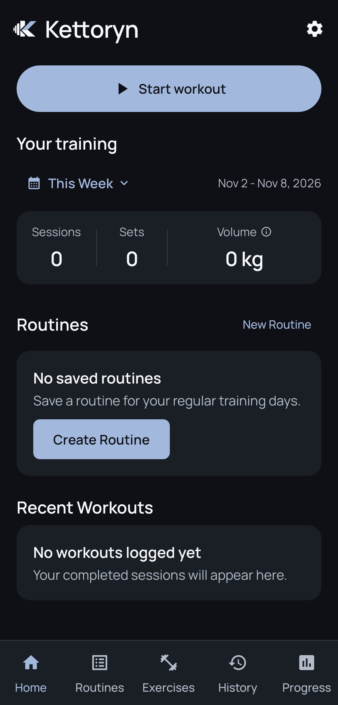
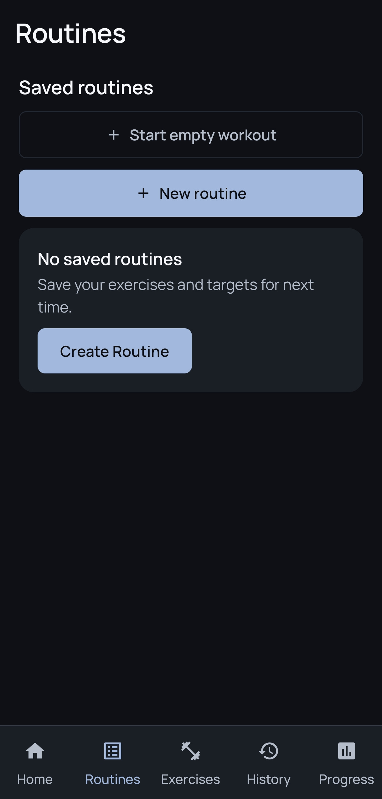
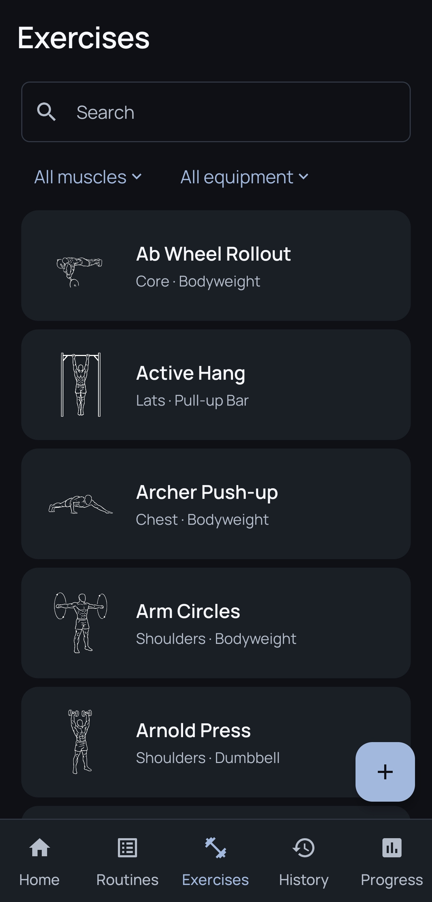
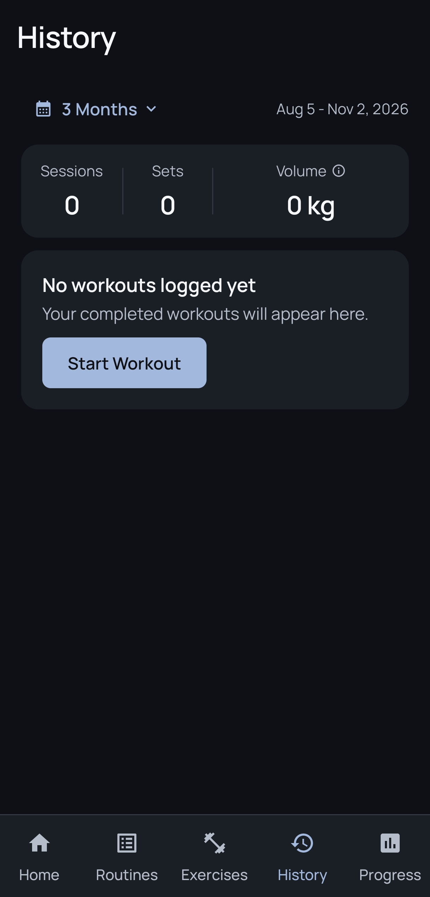
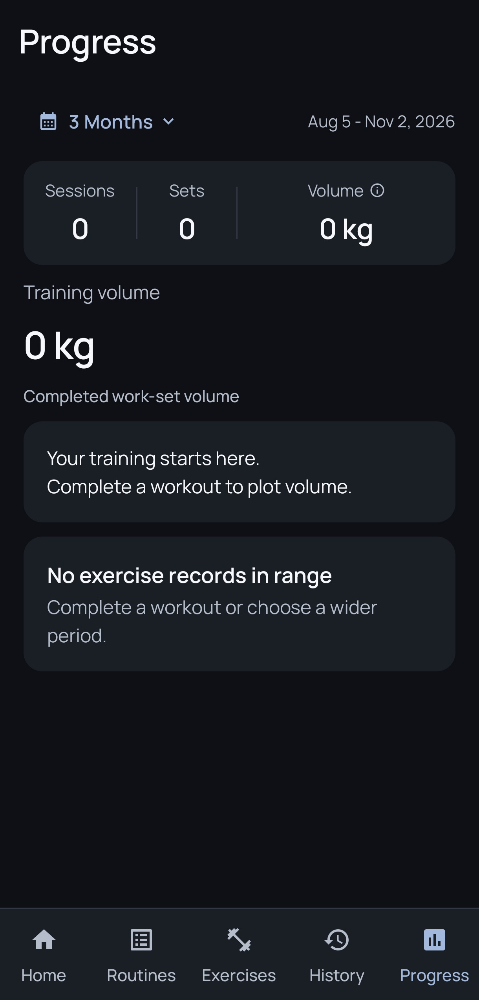
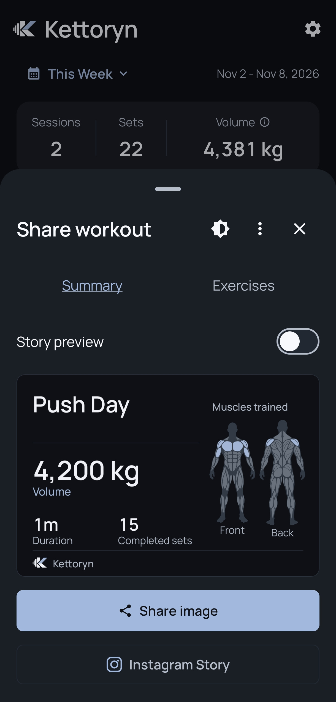
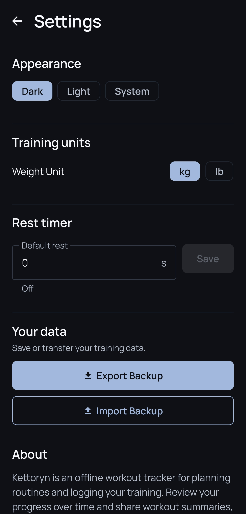

# Kettoryn

Kettoryn is an offline Android workout tracker for creating routines, recording sessions, and reviewing training progress. Keep your workout journal on your device and share completed sessions as workout summaries.

## Download & Installation

**[Download Kettoryn v1.0.0 for Android](Kettoryn-v1.0.0-release.apk)** · Android 8.0 or newer · One universal APK

1. Download the APK. If GitHub shows a file page, choose **Download raw file**.
2. Open the downloaded file using Android Files or your file manager.
3. If prompted, allow installation from that specific source.
4. Tap **Install**.
5. Open Kettoryn.

No ADB or Android Studio is required. The application works offline. Android may require security checks or developer verification depending on your device and distribution source; follow the instructions shown by Android.

**Protect your data:** debug and release builds signed with different certificates cannot directly overwrite one another. Export a backup in Settings and verify a copy outside the app before changing installation signatures. Importing a backup replaces the target installation's data. Future release updates must retain the same signing key and application ID and use a higher `versionCode`.

APK SHA-256:

```text
e54889caddbc115788eb3aaa734b2b591f79e996e57bf88576bd30393eaa6bd8
```

## Screenshots

### Training

<table>
  <tr><th>Home</th><th>Routines</th><th>Exercises</th></tr>
  <tr>
    <td></td>
    <td></td>
    <td></td>
  </tr>
</table>

### Tracking

<table>
  <tr><th>History</th><th>Progress</th></tr>
  <tr>
    <td></td>
    <td></td>
  </tr>
</table>

### Sharing and Preferences

<table>
  <tr><th>Workout Share</th><th>Settings</th></tr>
  <tr>
    <td></td>
    <td></td>
  </tr>
</table>

Exercise illustrations by Bryl Lim / Workout Guide, derived from Everkinetic; CC BY-SA 4.0. See [screenshot attribution](docs/screenshots/README.md) and [full asset notices](THIRD_PARTY_ASSETS.md).

## Features

### Workout Tracking

Start an empty workout or use a saved routine. Record weight and repetitions, bodyweight or assisted sets, duration, and distance with duration according to the exercise type. Add and manage sets; swipe to delete with confirmation and Undo. Per-exercise rest timers support pause, resume, adjustment and skip. Recover an interrupted workout, then complete it to save the session in History.

### Exercise Library and Routines

Browse 302 built-in exercises with three offline illustration frames each. Search the library and filter by muscle group or equipment. Create custom exercises with optional square-cropped photos stored privately on your device. Save and edit reusable routines for future sessions.

### Training History and Progress

Review completed workouts, session details and individual set results. See Muscle Split, Personal Records, training-volume charts, date-range filters and exercise-specific progress. Record and review body measurements alongside your training history.

### Sharing Workouts

Create Summary or exercise-list cards, including front/back anatomy with trained muscle-group highlights. Export portrait Story images or use Android's sharing options. Instagram Story sharing hands the image to a compatible external app; Kettoryn does not publish posts automatically.

### Offline and Personalization

Workouts and preferences stay local, with no required account or cloud sync. Choose Dark, Light or System appearance and kilogram or pound preferences. Export and import portable backups, including custom exercise photos. The production app has no Internet permission, advertising, analytics or tracking SDK; source links and sharing use external applications.

## Tech Stack

Kotlin, Jetpack Compose with Material 3, Navigation Compose, lifecycle ViewModel/StateFlow, Room (KSP), Preferences DataStore, coroutines, and Android Canvas for PNG rendering and anatomy exports. Tests use JUnit, Robolectric, Room testing and Android instrumentation. Exact dependency versions are in [the version catalog](gradle/libs.versions.toml).

## Building from Source

### Requirements

- Android SDK Platform 37 and Build Tools 37.0.0. The app has `minSdk = 26` and `targetSdk`/`compileSdk = 37`, with no maximum SDK restriction.
- JDK 25 for the Gradle daemon and a Java 21 compilation toolchain. The checked-in daemon toolchain configuration and Foojay resolver can provision toolchains where supported.
- Gradle 9.6.0 via the checked-in wrapper, Android Gradle Plugin 9.4.1 and Kotlin 2.2.10. Use a compatible Android Studio version or the command line.
- Network access to obtain build tools and Maven dependencies; installed-app use remains offline.

Open this directory in Android Studio, or configure `ANDROID_HOME` to your SDK installation and run:

```sh
chmod +x gradlew
./gradlew :app:testDebugUnitTest :app:assembleDebug --no-parallel --max-workers=2 --console=plain
```

The development APK is `app/build/outputs/apk/debug/app-debug.apk`. Instrumentation tests must use an isolated emulator, separate from personal installations:

```sh
./gradlew :app:connectedDebugAndroidTest --no-parallel --max-workers=2 --console=plain
```

### Signed release builds

Create your own permanent keystore outside this checkout. Create an external, permission-restricted properties file containing `storeFile` (absolute path), `storePassword`, `keyAlias`, and `keyPassword`. Do not commit either file. Set `KETTORYN_SIGNING_PROPERTIES` to that properties file, then run:

```sh
./gradlew :app:testDebugUnitTest :app:assembleRelease --no-parallel --max-workers=2 --console=plain
```

Output: `app/build/outputs/apk/release/app-release.apk`. The release task requires signing configuration and does not fall back to the debug key. Release shrinking and obfuscation are disabled. There are no ABI or density splits. Verify your APK with SDK `apksigner verify --verbose --print-certs` before distributing it. Retain the same signing key for future updates; a build signed with your own key cannot update the provided release APK.

Version `1.0.0` uses `versionCode = 2`. Increment the code for every distributed update; use `MAJOR.MINOR.PATCH` for user-facing versions. The application ID remains `com.williamchandra.kettoryn`.

## Offline Data & Backups

`MainActivity` hosts the Compose UI; `KettorynApplication` creates the Room database and repositories. Workouts, routines, sets and measurements live in Room, preferences in DataStore, and custom photos in app-private storage. The catalog and all 906 canonical illustration frames are bundled in the APK.

Settings → Export Backup writes a `.kettoryn` archive through Android's file picker. Import validates the archive and asks before replacing workouts, routines, exercises, measurements and settings. The current format includes optional custom photos and supports older archives. Room migrations preserve existing identities and historical snapshots.

Portable backups include units, appearance and default rest duration. Per-exercise rest overrides and running rest timers remain local and are not transferred by the current archive format.

**Backup archives are not encrypted by Kettoryn.** Keep them private and retain an external copy before changing phones, signatures or installations. There is no server copy; operating-system backup behavior depends on device settings and does not replace a portable export.

## Credits

Exercise artwork: Bryl Lim / Workout Guide, derived from Everkinetic (CC BY-SA 4.0). Anatomy vectors: Jsplice / MuscleMap contributors (MIT). Font: The Manrope Project Authors (SIL OFL 1.1). See [third-party assets and full notices](THIRD_PARTY_ASSETS.md); legal information is also available offline in Settings.

## License

Original Kettoryn application code is licensed under [MIT](LICENSE). Bundled third-party illustrations, anatomy vectors, fonts and dependencies retain their respective licenses, as detailed in [THIRD_PARTY_ASSETS.md](THIRD_PARTY_ASSETS.md). MIT does not cover the CC BY-SA exercise artwork or override other third-party terms.
